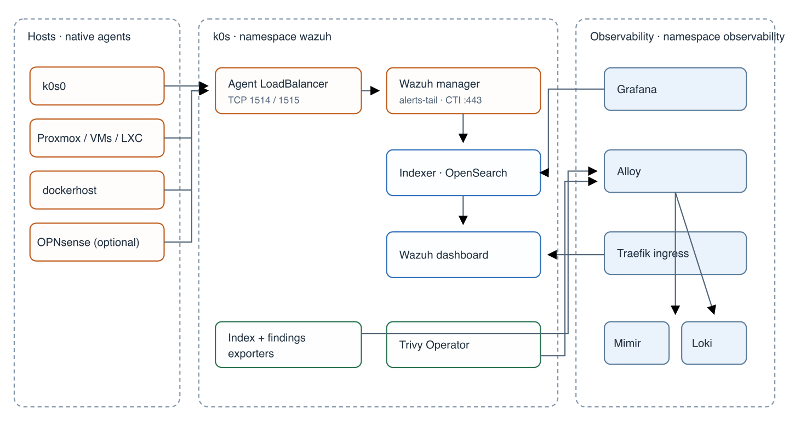

# Wazuh Security Monitoring

## Summary

**[Inference]** Deploy Wazuh 4.14.9 on single-node k0s, prioritizing host software inventory and vulnerability reporting; detection only, with no automated remediation or containment. The homelab operator owns triage. Grafana remains the primary interface; Trivy Operator separately covers k0s workload images. This is a plan, not a deployment.

## Current infrastructure

| Finding | Status |
|---|---|
| k0s is `v1.36.4+k0s.1` on one controller/worker, `k0s0` (`10.10.8.1`), with 12 CPU threads and 31 GiB RAM. Nodes 2 and 3 have not joined. | Verified (repo) |
| Longhorn 1.13.0 uses one replica and nightly QuObjects backups; default StorageClass is `longhorn`. | Verified (repo) |
| Observability uses Grafana, Loki, Mimir and Alloy; no Prometheus or Tempo. Grafana alerts are Mimir-only and route critical severity to emergency Pushover. | Verified (repo) |
| LAN ingress uses Traefik, MetalLB and cert-manager; Cloudflare supplies DNS only. | Verified (repo) |
| `vm.max_map_count`, free capacity, spare MetalLB IP, CNI NetworkPolicy enforcement, and dockerhost routing to MetalLB | Needs live check |
| Wazuh 4.14.9 is the upstream stable release as of 2026-10-26; 5.0 is a breaking rewrite. | Verified (upstream): https://github.com/wazuh/wazuh/releases/tag/v4.14.9 ; https://github.com/wazuh/wazuh-kubernetes/blob/main/docs/ref/upgrade.md |

## Recommended architecture

**[Inference]** Run one indexer, one standalone manager and one dashboard in namespace `wazuh`, on k0s0. Adapt official v4.14.9 manifests into a repository-native Pulumi Python workspace.

| Resource | Kind | Image | Ports | Persistent storage |
|---|---|---|---|---|
| `wazuh-indexer` | StatefulSet, 1 replica | `wazuh/wazuh-indexer:4.14.9` | 9200, 9300 | 50Gi Longhorn |
| `wazuh-manager` | StatefulSet, 1 replica; alerts-tail sidecar | `wazuh/wazuh-manager:4.14.9` | 1514, 1515, 55000 | 20Gi Longhorn |
| `wazuh-dashboard` | Deployment, 1 replica | `wazuh/wazuh-dashboard:4.14.9` | 5601 TLS | — |
| Indexer exporter | Deployment | Elasticsearch exporter 1.11.0 | 9114 | — |
| Findings exporter | Deployment | JSON exporter 0.8.0 | 7979 | — |

**[Verified (upstream)]** Official Kubernetes manifests are Kustomize, not a Helm chart: https://github.com/wazuh/wazuh-kubernetes/tree/v4.14.9. **[Inference]** Replace demo credentials/certificates, privileged sysctl, unpinned init image, MicroK8s storage class, public load balancers, and three-node HA assumptions.

## Component responsibilities

- **[Inference]** Manager collects host inventory, vulnerability findings and security events; indexer stores them; dashboard retains Wazuh administration and IT Hygiene workflows.
- **[Inference]** Grafana provides the primary cross-system view; selected alert logs go to Loki, while vulnerability state stays in OpenSearch.
- **[Verified (upstream)]** Wazuh Vulnerability Detection correlates syscollector inventory with CTI feeds; coverage includes major Linux distributions but not FreeBSD: https://documentation.wazuh.com/current/user-manual/capabilities/vulnerability-detection/compatibility-matrix.html

## Network communication

| Flow | Port | Access |
|---|---:|---|
| Agents to manager | TCP 1514, 1515 | MetalLB fixed IP, source allowlist |
| Dashboard to manager API | TCP 55000 | Cluster-only |
| Manager/exporters/dashboard/Grafana to indexer | TCP 9200 | Cluster-only, TLS |
| Indexer node transport | TCP 9300 | Indexer only |
| Traefik to dashboard | TCP 5601 | Cluster-only, TLS re-encryption |
| Manager to CTI | TCP 443 | Egress |

**[Inference]** Dashboard URL is `https://wazuh.4jp.de`; agent endpoint is `wazuh-manager.4jp.de`. API and indexer remain ClusterIP-only.

## Persistent storage

**[Inference]** Use Longhorn 1-replica PVCs: 50Gi indexer and 20Gi manager, both in nightly backup group. Keep OpenSearch replicas at zero on the single node; avoid double replication. Retain alerts 60 days, monitoring/statistics 30 days with ISM. Backups are crash-consistent; a failed indexer restore may require rebuilding state from manager inventory, losing alert history. Manager state, especially `client.keys`, is the highest-value recovery asset.

## Resource allocation

| Component | CPU request | Memory request | Memory limit | Storage |
|---|---:|---:|---:|---:|
| Indexer, 2Gi heap | 500m | 3Gi | 4Gi | 50Gi |
| Manager | 500m | 1536Mi | 3Gi | 20Gi |
| Dashboard | 100m | 512Mi | 1Gi | — |
| Sidecar | 10m | 16Mi | 32Mi | — |
| Each exporter | 10m | 32Mi | 64Mi | — |
| Config Job (transient) | 100m | 512Mi | 1Gi | — |

**[Inference]** Total requests: about 1.13 CPU and 5.2Gi memory; limits about 8.2Gi; storage 70Gi. Confirm capacity live before implementation. Minimal sizing uses 1Gi indexer heap but is not recommended with vulnerability detection. HA requires three nodes, three indexers and a manager worker.

## LGTM integration

**[Inference]** Grafana queries OpenSearch for current findings and uses aggregate Mimir metrics for trends/health. Loki receives selected Wazuh alert events and manager `ossec.log` feed lifecycle lines. New Active Critical findings alert through separate Loki Grafana alert rules, grouped per agent over five minutes; parse source timestamps, falling back to arrival time if parsing fails. Delivery is best-effort; Wazuh alert indices remain authoritative. The current finding state and transition-event stream are distinct; event gaps mean the stream is not a complete lifecycle ledger.

Capabilities still requiring Wazuh dashboard: agent management/groups, IT Hygiene inventory, SCA, FIM events, ruleset/decoder testing, and API console.

**[Verified (upstream)]** Vulnerability state index is `wazuh-states-vulnerabilities-*`; its fields include `vulnerability.detected_at`, severity, score and scanner condition, but no `@timestamp` or fixed-version field. Inventory state indices likewise have no `@timestamp`. https://documentation.wazuh.com/current/user-manual/wazuh-indexer/wazuh-indexer-indices.html

**[Verified (upstream)]** Vulnerability transition alerts use `agent.id`, `data.vulnerability.cve`, `data.vulnerability.package.name`, `data.vulnerability.status` (`Active`/`Solved`) and the alert’s top-level `timestamp`. Initial inventories/rescans can omit events; some hotfix resolutions identify “one or many packages.” Use current state for authoritative posture, not event history. https://github.com/wazuh/wazuh/blob/v4.14.9/ruleset/rules/0520-vulnerability-detector_rules.xml ; https://documentation.wazuh.com/4.14/user-manual/capabilities/vulnerability-detection/how-it-works.html
**[Verified (upstream)]** Manager `ossec.log` contains scanner messages `Feed update process completed.` and `Error updating feed: ...`; the sidecar/Loki signal is indirect and silence does not prove failure. https://documentation.wazuh.com/4.14/user-manual/reference/ossec-conf/logging.html ; https://github.com/wazuh/wazuh/blob/v4.14.9/src/wazuh_modules/vulnerability_scanner/src/databaseFeedManager/databaseFeedManager.hpp

## Agent strategy

| Platform | Approach | Coverage |
|---|---|---|
| Debian-family hosts (k0s0 first, then explicitly approved hosts) | Native agent via Ansible | Host inventory and supported OS CVEs; Proxmox-specific CVE coverage is partial (Inference) |
| OPNsense | Community plugin, manual and non-blocking | Event forwarding in v1; tier-3/as-is and no reliable FreeBSD CVE coverage (Verified (upstream): https://docs.opnsense.org/manual/wazuh-agent.html) |
| QNAP | No agent | Syslog remains in Loki; track QTS advisories manually (Verified (repo)) |

**[User decision]** Use k0s0 as a stop/go pilot; expand only to listed, approved Debian-family hosts. Include Proxmox with partial coverage stated. No DaemonSet: native agents provide host inventory and can report through kubelet failure. Agent versions must not exceed the manager.

## Container vulnerabilities

**[Inference]** Add Trivy Operator for k0s workload images only, vulnerability scanner only, Standalone, concurrency 1. Export metrics to Mimir; do not duplicate findings in Wazuh. Dockerhost image scanning remains out of scope. Trivy 0.69.4 was affected by a supply-chain compromise; use the chart's later 0.75.0 image. https://github.com/advisories/GHSA-69fq-xp46-6x23

## Security architecture

**[Inference]** Internal Pulumi TLS CA and cert-manager leaf certificates; RSA PKCS#8 leaf keys. Generate passwords in Pulumi, remove demo users, apply security configuration with `securityadmin.sh`. **[Verified (upstream)]** Security config changes after initial startup require `securityadmin.sh`: https://documentation.wazuh.com/current/deployment-options/docker/wazuh-container.html

**[User decision]** Initially allow agent traffic from `10.10.0.0/16` plus the dockerhost `/32`, and leave pod egress open; tighten after observed flows and the approved host list. The dashboard is LAN-only. Internal Authentik SAML is optional after core rollout; retain local basic authentication as break-glass. **[Verified (upstream)]** Wazuh documents this SAML/basicauth arrangement: https://documentation.wazuh.com/current/user-manual/user-administration/single-sign-on/authentik.html

## Operational lifecycle

**[Inference]** Upgrade by reviewing release notes, backing up both volumes, previewing/applying Pulumi, verifying, then upgrading agents. Retain alert indices for 60 days and do not store archive streams. Local QuObjects backups are acceptable initially; restore tests are required, while off-site replication is not a go-live gate. A 5.x move is a separate deployment/migration. Wazuh downtime is accepted and agents buffer events.

## Resource and risk assessment

**[Inference]** Main risks: single-node outage; memory/disk pressure; CTI staleness detected only indirectly from logs; best-effort Loki notification gaps; noisy initial scans; manager compromise grants indexer-admin access; enrollment does not verify manager certificate; broad initial network policy; 5.x migration debt; Grafana ConfigMap growth; and local-only backups pending later off-site review. About 600 Mimir series are expected for Wazuh and up to 1,000 for Trivy, against roughly 36k free headroom.

## References

- https://github.com/wazuh/wazuh/releases/tag/v4.14.9
- https://github.com/wazuh/wazuh-kubernetes/tree/v4.14.9
- https://github.com/wazuh/wazuh-kubernetes/blob/main/docs/ref/upgrade.md
- https://github.com/wazuh/wazuh-kubernetes/blob/main/docs/ref/backup-restore.md
- https://documentation.wazuh.com/current/quickstart.html
- https://documentation.wazuh.com/current/installation-guide/wazuh-indexer/index.html
- https://documentation.wazuh.com/current/user-manual/wazuh-indexer/wazuh-indexer-indices.html
- https://github.com/grafana/grafana-opensearch-datasource
- https://github.com/prometheus-community/json_exporter
- https://github.com/prometheus-community/elasticsearch_exporter
- https://github.com/aquasecurity/trivy-operator

- https://documentation.wazuh.com/4.14/user-manual/reference/ossec-conf/logging.html
- https://github.com/wazuh/wazuh/blob/v4.14.9/src/wazuh_modules/vulnerability_scanner/src/databaseFeedManager/databaseFeedManager.hpp
- https://documentation.wazuh.com/current/user-manual/user-administration/single-sign-on/authentik.html
## Related notes

[[ADR-0037 - Wazuh security monitoring on k0s]], [[Wazuh Implementation Plan]], [[GLOSSARY]], [[ADR-0019 - LGTM observability stack on k0s]], [[ADR-0014 - Longhorn on a dedicated ext4 data disk]], [[ADR-0024 - QNAP syslog into Loki]], [[ADR-0029 - Service names as Cloudflare A records]]
