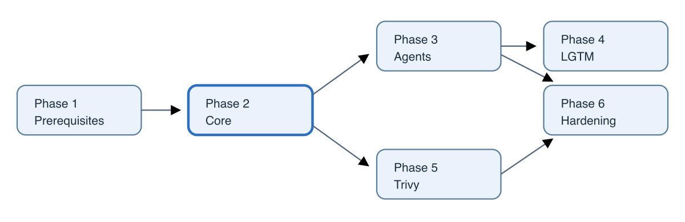

# Wazuh Implementation Plan

## Overview

**[User decision]** Wazuh is for host inventory and vulnerability reporting, with manual operator triage and no automated response. No live changes are made by this plan. Capacity check T1.2 gates sizing. Tasks list description, prerequisites, repository changes, verification, acceptance, rollback, manual requirement and effort.

## Phases

### Phase 1: Prerequisites (≈0.5 day)

| Task | Description | Prerequisites | Repository changes | Verification / acceptance | Rollback | Manual | Effort |
|---|---|---|---|---|---|---|---|
| T1.1 | Run `scripts/pull-donors`; search both donors for Wazuh and Trivy. | Repo access | None | Fresh donor findings recorded. | None | No | Small |
| T1.2 | Check `kubectl top node`, `kubectl describe node k0s0` allocated resources, Longhorn schedulable space. | Cluster access | None | ≥6Gi unrequested allocatable memory, ≥10Gi actually free, ≥150Gi Longhorn schedulable; otherwise minimal sizing. | None | Yes | Small |
| T1.3 | Check `sysctl vm.max_map_count` on k0s0; if below 262144 add/run `tune-kernel-opensearch.yaml`. | SSH/Ansible access | Conditional Ansible playbook | Host value ≥262144. | Revert sysctl file | Yes | Small |
| T1.4 | List LoadBalancer services and choose free MetalLB IP. | Cluster access | Record config | A free address; prefer `10.10.88.3`. | None | Yes | Small |
| T1.5 | Confirm CNI NetworkPolicy enforcement and Longhorn evidence. | Cluster access | None | Enforcement verified. | None | Yes | Small |
| T1.6 | From candidate hosts, `curl -kI https://10.10.88.1`; dockerhost routing is critical. | Candidate host access | None | Route to MetalLB range proven or dockerhost deferred. | None | Yes | Small |
| T1.7 | Supply host names, IPs, OS and agent groups. | User host inventory | New inventory inputs | Each intended host represented. | Remove entries | Yes | User input |
| T1.8 | Extract 4.14.9 security role files and identify OpenSearch version from image. | Docker access | Record upstream baseline | Files/version captured. | None | No | Small |

### Phase 2: Core (≈2–3 days)

| Task | Description | Prerequisites | Repository changes | Verification / acceptance | Rollback | Manual | Effort |
|---|---|---|---|---|---|---|---|
| T2.1 | Create `services/wazuh` following Tandoor; add `pulumi-tls`; create prod stack. | Phase 1; stack credentials | Pulumi workspace | Preview succeeds. | Destroy empty stack | Yes (stack creation) | Medium |
| T2.2 | Implement CA and cert-manager certificates. | T2.1 | PKI resources | Certificates ready; PKCS#8 keys. | Remove resources | No | Medium |
| T2.3 | Generate credentials and render internal users config. | T2.1 | Secrets and security files | No demo users; bcrypt hashes valid. | Remove stack resources | No | Medium |
| T2.4 | Implement single indexer, Services and hashed security/ISM Job. | T2.2–2.3 | Indexer manifests/config | Green cluster, indices visible; reader cannot write. | Destroy stack; inspect PVC reclaim first | No | Large |
| T2.5 | Implement manager, services, read-only sidecar tails for alerts and `/var/ossec/logs/ossec.log`, config and agent DNS. | T2.2–2.4 | Manager resources/assets | CTI feed completion appears in logs; agent endpoint reachable from allowed sources. | Destroy stack | No | Large |
| T2.6 | Implement dashboard, ServersTransport, IngressRoute and DNS. | T2.2–2.4 | Dashboard/ingress resources | Login at `https://wazuh.4jp.de`. | Remove ingress/DNS | No | Medium |
| T2.7 | Add NetworkPolicies and namespace baseline PSA label. | Pod labels identified | Policies/config | Default namespace cannot reach indexer; required flows work. | Remove policies/label | No | Medium |
| T2.8 | Deploy indexer and findings exporters. | T2.4, credentials | Exporter deployments/config | Indexer metrics and JSON probe metrics returned. | Remove exporters | No | Medium |

**Phase 2 acceptance:** `pulumi preview`, then deploy; all pods Ready; `_cluster/health` green; state and alert indices exist; dashboard local login succeeds; first feed update completes; Grafana reader gets 403 on write and 200 on search; default namespace cannot reach indexer; exporter endpoints return expected metrics. This is deployment readiness, not final acceptance before the k0s0 pilot.

### Phase 3: Agents (≈1 day)

| Task | Description | Prerequisites | Repository changes | Verification / acceptance | Rollback | Manual | Effort |
|---|---|---|---|---|---|---|---|
| T3.1 | Add Debian-family installer playbook and inventory; other Linux distributions are deferred unless a tested installer is added. | Phase 1 host list; Phase 2 endpoint | `services/wazuh/ansible/` | Playbook syntax and repository checks. | Remove playbook/inventory | No | Medium |
| T3.2 | Create groups: `k0s-nodes`, `proxmox`, `vms`, `lxc`, `docker-hosts`, `opnsense`. | Manager live | None or initialization config | Groups present. | Remove groups | Yes | Small |
| T3.3 | Enroll k0s0 as a stop/go pilot. | T3.1–3.2, enrollment secret | Inventory host | Within 1h package docs match dpkg count ±5%; process/network inventory and current vulnerability findings appear; review load, feed health and event behavior before expansion. | Purge agent and remove manager ID | Yes | Medium |
| T3.4 | Enroll only explicitly inventoried and approved Debian-family Proxmox hosts, VMs, LXCs and dockerhost. | T3.3 accepted; routing verified | Inventory entries | Intended agents active/reporting; Proxmox-specific CVE limitation recorded. | Purge agent/remove IDs | Yes | Medium |
| T3.5 | Install the tier-3/as-is OPNsense community plugin manually for event forwarding; non-blocking to rollout. | Phase 2 manager; GUI access | Record integration config | Auth/IDS events and agent health visible; no CVE coverage claimed. | Remove plugin/agent | Yes | Small |

### Phase 4: LGTM (≈2 days)

| Task | Description | Prerequisites | Repository changes | Verification / acceptance | Rollback | Manual | Effort |
|---|---|---|---|---|---|---|---|
| T4.1 | Add Grafana plugin and OpenSearch datasources via StackReference. | Phase 2; live OpenSearch version | Observability Pulumi | Datasource Save & test passes. | Revert observability stack | No | Medium |
| T4.2 | Add Alloy scrapes and log pipelines for alert-tail and read-only `ossec.log` tail; retain vulnerability events and parse source timestamps, falling back to arrival time if parsing fails. | T4.1; sidecar mounts verified | Alloy config and manager pod | Active/Solved lines and feed completion/error lines arrive in Loki with correct timestamps; discarded samples do not increase. | Revert Alloy config | No | Medium |
| T4.3 | Add Wazuh security dashboard. | T4.1–4.2 | `dashboards.py` | Current findings, alert events, feed freshness and other panels return valid data. | Remove dashboard | No | Large |
| T4.4 | Add Mimir health/agent rules and separate Loki rules for Active Critical findings and CTI health; all start at warning. | T4.1–4.2; source fields verified live | Existing Mimir rules plus Wazuh-specific Loki rule definitions | Test no-data, event-burst, feed-error and stale-success cases; all rules healthy and warning route reaches normal Pushover. | Remove rules | No | Large |
| T4.5 | Keep ADR proposed until Phase 2 deployment verification; refresh OKF with verified implementation results. | Phase 2 complete | ADR/OKF edits | Proposal status matches actual deployment gate. | Restore prior note | No | Small |

Mimir Grafana alert rules: `wazuh-agent-disconnected` (inactive for 1h); `wazuh-indexer-red` (red for 10m); `wazuh-indexer-disk-low` (<20% available for 30m); `wazuh-manager-down` (not ready for 10m); `wazuh-high-level-event` (level ≥12 in 15m, for 1m). Loki Grafana alert rules: newly Active Critical finding events grouped by agent over 5m; explicit CTI feed errors; and no successful feed completion observed for 2h. Do not alert merely because no security alert was emitted in a quiet period. All new Grafana alert rules based on Wazuh data start at `severity=warning` and route to normal Pushover; review after about two weeks and promote only with reviewed evidence. Wazuh detection-rule levels are separate. Finding events are best-effort and the Wazuh index is authoritative.

### Phase 5: Trivy (≈0.5–1 day)

| Task | Description | Prerequisites | Repository changes | Verification / acceptance | Rollback | Manual | Effort |
|---|---|---|---|---|---|---|---|
| T5.1 | Add Trivy Operator vulnerability-only module in platform stack. | Phase 2; capacity | Kubernetes Pulumi module/config | Operator runs Standalone, concurrency 1; other scanners disabled. | Remove release | No | Medium |
| T5.2 | Scrape metrics and add dashboard row. | T5.1 | Alloy/dashboard | Metrics for namespaces; active series increase <1,000. | Revert scrape/panel | No | Small |

### Phase 6: Hardening and operations (≈1 day)

| Task | Description | Prerequisites | Repository changes | Verification / acceptance | Rollback | Manual | Effort |
|---|---|---|---|---|---|---|---|
| T6.1 | Restore manager backup to new volume. | Backups available | Runbook record | `etc/client.keys` line count preserved. | Delete test volume | Yes | Medium |
| T6.2 | Test indexer restore or manager-based rebuild. | Backups; Phase 2 | Runbook record | Restore/rebuild behavior verified. | Restore original PVC | Yes | Medium |
| T6.3 | Test read-only users and NetworkPolicy negatives. | Phase 2 | None | No unauthorized writes or connections. | Revert test changes | Yes | Small |
| T6.4 | Write operations runbook. | Verification findings | `docs/06-Operations/Runbook - Wazuh Operations.md` | Upgrade, certificate restart and troubleshooting covered. | Revert doc | No | Medium |
| T6.5 | Rehearse next 4.14.x upgrade. | Backup and runbook | Record outcome | Upgrade and rollback path exercised. | Restore backup/version | Yes | Medium |
| T6.6 | Review alert noise after about two weeks; promote selected severities only with reviewed evidence. | Two weeks of data | ADR/rule updates | Promotion justified by observed noise and actionable response. | Revert severity | Yes | Small |
| T6.7 | Optionally add Authentik SAML after core rollout; preserve local basic break-glass login. | Core operational; SAML role mapping tested | Dashboard/indexer security config | SAML and local fallback both work; no SSO go-live dependency. | Disable SAML domain and use local login | Yes (IdP setup) | Large |

## Recommended first task

**T1.2: live capacity check.** It gates all sizing decisions; T1.3 and T1.4 can follow in the same session.

## Open questions

| Question | Why it matters | How to resolve | Provisional answer |
|---|---|---|---|
| Which Debian-family hosts are approved after the k0s0 pilot? | Defines explicit onboarding and groups; unsupported OS automation is out of scope initially. | Proxmox and NetBox review, then provide names/IPs/OS/groups in T1.7. | k0s0 first; expand only to explicitly approved hosts. |
| Can `192.168.178.0/24` reach `10.10.88.0/24`? | Determines dockerhost enrollment path if approved. | T1.6 route test. | Defer dockerhost if blocked. |
| Is k0s0 capacity sufficient? | Gates recommended sizing. | T1.2 live metrics and storage check. | Recommended sizing if thresholds pass. |
| What is host `vm.max_map_count`? | OpenSearch bootstrap requirement. | T1.3 SSH check. | Add Ansible sysctl playbook if below 262144. |
| Which MetalLB IP is free? | Agent endpoint must be stable. | T1.4 service inventory. | `10.10.88.3`. |
| When is Wazuh 5.0 GA suitable? | Migration is breaking. | Monitor releases. | Migrate after 5.0.1. |
| What are the live fields/timestamp formats for agent status and vulnerability events? | Required for state panels and Loki event rules. | Inspect v4.14.9 documents/logs in Phases 2 and 4. | Verify before enabling rules. |
| When will HBS 3 off-site backup be verified? | Determines later off-site protection, but is not a Wazuh go-live gate. | Verify ADR-0016 job and restore. | Local QuObjects backups accepted initially; restore tests required. |
| Which OpenSearch datasource provisioning keys are valid? | Required for TLS and query mode. | Check plugin provisioning docs in T4.1. | Verify `tlsAuthWithCACert`, `flavor`, `version`. |

## Related notes

[[Wazuh Security Monitoring]], [[ADR-0037 - Wazuh security monitoring on k0s]], [[GLOSSARY]], [[ADR-0019 - LGTM observability stack on k0s]], [[ADR-0014 - Longhorn on a dedicated ext4 data disk]]
